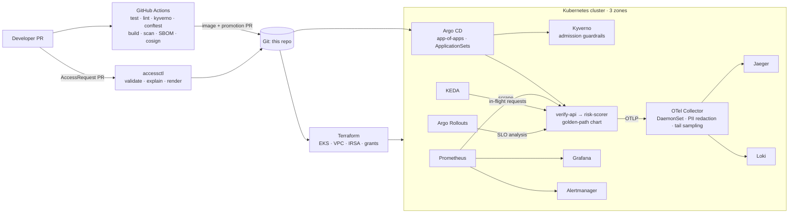

# Ridgeline

**An opinionated Kubernetes platform for a high-compliance identity API, built to make change safe.**

Ridgeline is a working internal developer platform you can run on a laptop and
read like a production one. It hosts a small identity-verification service
(phone number in, approve/review/deny out) and wraps it in everything a
platform team owns: a golden-path Helm chart, GitOps with Argo CD,
SLO-gated canary releases, policy guardrails, default-deny networking,
self-service least-privilege access, end-to-end telemetry, Terraform for EKS,
and a set of labs that break the system on purpose and fix it with data.

> A platform is the ability to make change safely. A developer working in
> isolation shouldn't need to know about connection limits, CPU quotas or
> cross-account permissions to ship. The platform should know for them.

## The two problems it is designed around

Most requests to a platform team are some version of two questions:

1. **"Can my service reach X?"** (permissions, by far the most frequent).
   Under default-deny, every new path between a service, a datastore, an AWS
   resource or an external API is a coordination problem.
   → Ridgeline turns that into a **self-service pull request** that is
   validated, explained, routed to the right owners, rendered into
   least-privilege IAM and NetworkPolicy, and **expires automatically**.
   See [`access-requests/`](access-requests/) and [`tools/accessctl`](tools/accessctl/).

2. **"What is my service doing?"** (logs, metrics, traces).
   → Every service on the golden path gets RED metrics, distributed traces
   with PII redacted at two layers, trace-correlated JSON logs, a dashboard and
   multi-window burn-rate SLO alerts **without writing any of it**.

## Architecture



## What's in the box

| Area | Where | What it shows |
|---|---|---|
| **Golden-path chart** | [`charts/platform-service`](charts/platform-service/) | Size presets (no CPU limit by design), startup/readiness/liveness probes, preStop drain, hard zone spread, PDB, restricted security context, IRSA, default-deny baseline, ServiceMonitor, generated SLO burn-rate alerts, KEDA autoscaling on a custom metric, optional Argo Rollouts canary with automatic SLO analysis, JSON-schema-validated values |
| **GitOps** | [`gitops/`](gitops/) | Argo CD app-of-apps, sync waves, ApplicationSets for platform components and for tenants (one directory = one service), AppProjects that stop a tenant from creating cluster-scoped objects, prod sync windows |
| **Self-service access** | [`tools/accessctl`](tools/accessctl/), [`access-requests/`](access-requests/) | Go CLI: strict schema, catalog of grantable resources and actions, no wildcards, mandatory expiry per environment, PII needs a risk exception and security review, owner-based approver routing, audit metadata on every rendered object, nightly expiry PRs |
| **Policy as code** | [`policies/`](policies/) | Kyverno: requests/limits, probes, Pod Security "restricted", trusted registries + immutable tags, cosign signature verification in prod, generated default-deny per namespace. OPA/conftest on Terraform plans: no `*`, no IAM from workloads, no public buckets |
| **Observability** | [`gitops/platform`](gitops/platform/), [`services/ridgeline_common`](services/ridgeline_common/) | OpenTelemetry SDK + Collector (k8s metadata, OTTL PII redaction, tail sampling keeping all errors and slow traces), Prometheus, Grafana dashboard, Loki with trace↔log links, Jaeger, platform alerts (CPU throttling, pending pods, zone imbalance, connection saturation) |
| **Infrastructure as code** | [`infra/terraform`](infra/terraform/) | EKS across 3 AZs, private endpoint, KMS-encrypted secrets, audit + flow logs, VPC CNI NetworkPolicy enforcement, IMDSv2 hop-limit 1, an IRSA role per catalog workload fenced by a permissions boundary |
| **CI/CD** | [`.github/workflows`](.github/workflows/) | GitHub Actions: tests, lint, chart render + kubeconform, policy tests, Terraform validate, image build with provenance/SBOM, Trivy gate, keyless cosign signing, GitOps promotion PRs, kind e2e smoke test, access-request plan comments, OIDC-based Terraform apply with plan policy checks |
| **Labs** | [`labs/`](labs/) | Seven break-observe-diagnose-fix exercises: rollbacks and canaries, CPU throttling, scaling that makes things worse, scheduling and zone failure, probes and graceful shutdown, OOM and admission control, default-deny debugging |
| **Operations** | [`docs/`](docs/) | Runbooks for every alert, a blameless postmortem template, design decisions |

## The services

Two small Python (FastAPI) services, deliberately boring so the platform is the interesting part:

- **verify-api** pseudonymizes the phone number at the edge (it never reaches a
  log line or a span), calls risk-scorer through a bounded connection pool,
  and returns a decision.
- **risk-scorer** returns a deterministic risk score from behind a simulated
  datastore with a hard connection ceiling, the way a real database has
  `max_connections`.

Both expose `/healthz`, `/readyz`, `/metrics`, propagate W3C trace context,
and carry **failure-injection knobs** (CPU burn, latency, error rate, slow
start, memory leak) that the labs use to reproduce production failures.

## Quickstart (local, ~10 minutes)

Requirements: Docker, [kind](https://kind.sigs.k8s.io/), kubectl, Helm, Go 1.24+, Python 3.12+.
Argo CD syncs from GitHub, so push this repo to your own account first and
update `repoURL` in `gitops/` if the path differs.

```bash
make check            # the same tests and validations CI runs
make lab-up           # kind (3 zones) + Calico + Argo CD → GitOps installs the rest
make ui               # Grafana :3000, Prometheus :9090, Jaeger :16686, Argo CD :8081
make load RPS=100     # in-cluster k6 against verify-api
```

Then open [`labs/README.md`](labs/README.md).

Try the access workflow without a cluster:

```bash
go run ./tools/accessctl explain access-requests/
go run ./tools/accessctl expired -within 30 access-requests/
```

## Design decisions

The short version (long version in [`docs/design-decisions.md`](docs/design-decisions.md)):

- **Kubernetes is the opinion.** One way to run an HTTP service, encoded once in
  a chart, instead of each team choosing its own hosting model.
- **Git is the only way in.** Argo CD reconciles everything; manual changes are
  reverted. Deploys, rollbacks, access grants and their removal are all PRs.
- **Guardrails over gates.** Policies explain what to change; the golden path
  passes them by default, so the secure path is also the easy one.
- **No CPU limits by default, always a memory limit.** Throttling causes tail
  latency; memory can only be killed, so it gets a blast radius.
- **Scale on the signal that matches the bottleneck.** In-flight requests for
  I/O-bound services, CPU only where CPU is the constraint, and never scale a
  caller past what its downstream can serve.
- **Access is temporary by construction.** No request without an expiry; PII
  outside production needs a risk exception and is capped at 14 days.

## Production gaps (what I would add next)

This is a lab, so some things are intentionally simplified. In production:

- **Five nines.** 99.999% allows ~26 seconds of downtime a month, which no
  single cluster or region can promise. That target means multi-region
  active-active, cell-based isolation, and SLOs per dependency. Here the
  default SLO is 99.9% so the burn-rate math is visible in a lab.
- Karpenter for node provisioning, External Secrets for secret sync, Argo CD
  managing multiple clusters, durable storage for Loki/Jaeger (S3), mTLS via a
  service mesh or Cilium, VPA recommendations feeding size presets, and an
  approval check that verifies `accessctl`'s required reviewers actually approved.

## Repository map

```
services/            verify-api, risk-scorer, shared telemetry/redaction/lifecycle library
charts/              platform-service golden-path Helm chart (+ CI values)
gitops/              Argo CD bootstrap, projects, ApplicationSets, platform values, tenant values
access-requests/     catalog, AccessRequests per environment, rendered grants
tools/accessctl/     the access-request CLI (Go)
policies/            Kyverno guardrails + tests; conftest policies for Terraform plans
infra/               kind cluster config; Terraform for EKS, IRSA and access grants
labs/                break-it/fix-it exercises
loadtest/            k6 load profile and in-cluster Job
docs/                runbooks, postmortem template, design decisions
```

---
Built by [Sujit Bhandari](https://github.com/Sujitbhandari).
